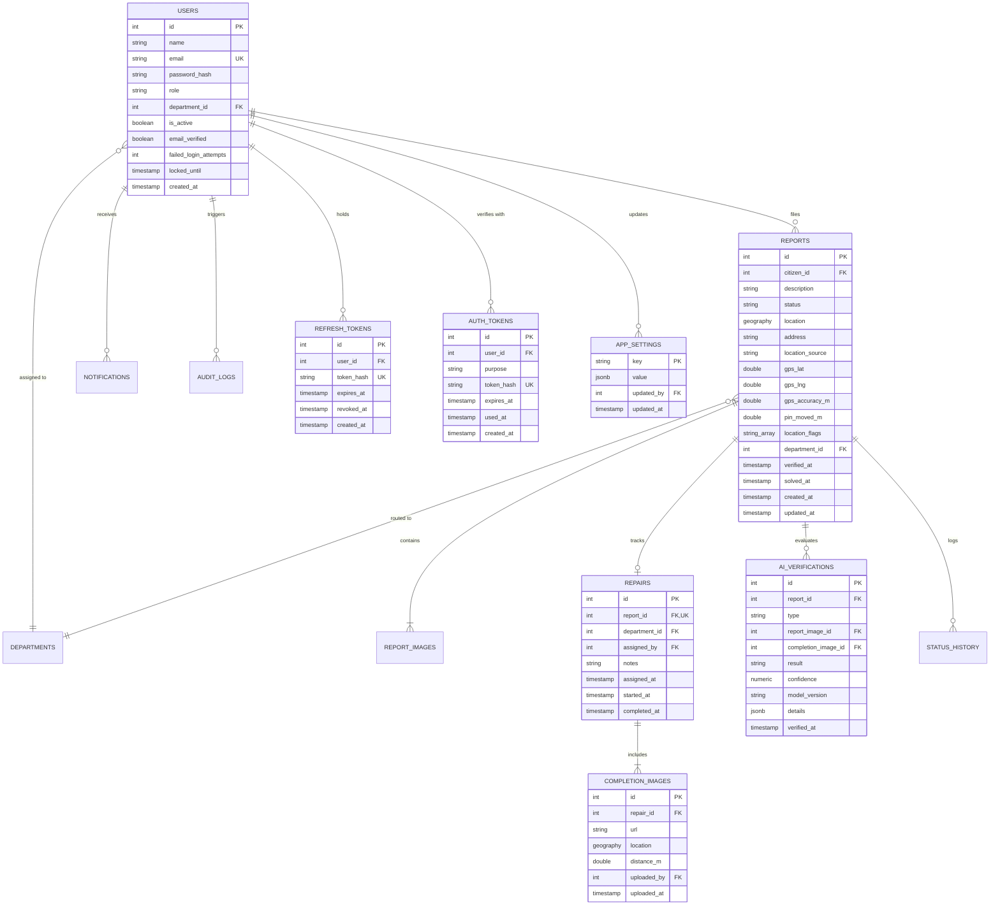
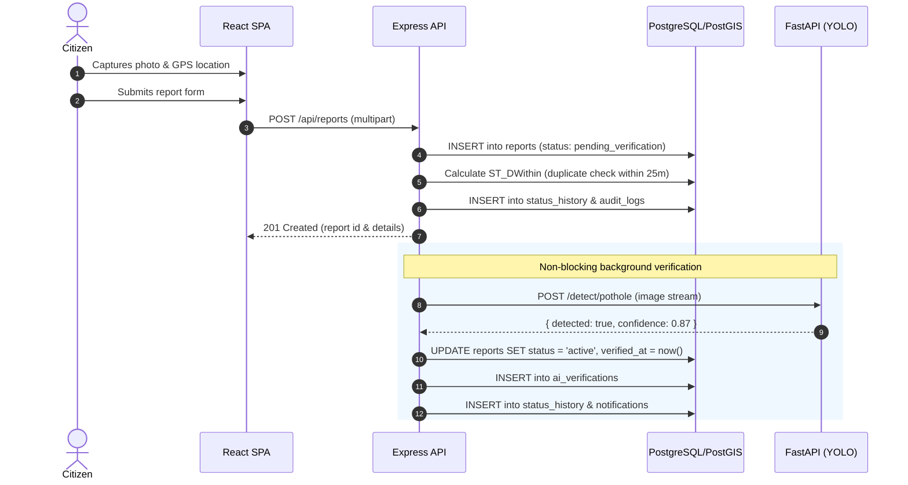
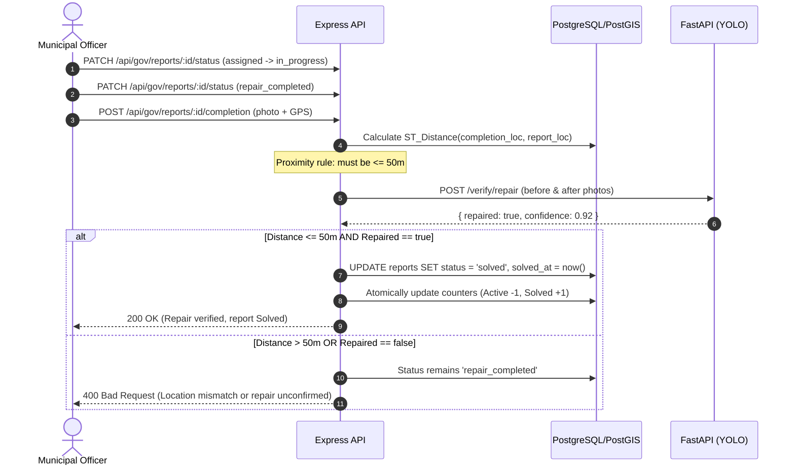

# System Architecture & Technical Design Specification

> **Project:** Smart Civic Road Issue Reporting and AI-Based Pothole Verification System  
> **Status:** Phase 3 Completed (Live Map Clustering, Gov Portal Upgrades, Admin Governance & Analytics Live) · Next: Phase 4 (YOLO Dataset & Training)

---

## 1. System Overview & Architecture

The platform is designed as an event-driven, decoupled system consisting of a React single-page frontend, an Express REST API backend, a PostgreSQL relational database with PostGIS spatial extensions, and a Python FastAPI computer vision microservice.

```
                           CITIZEN / PUBLIC CLIENT
                           [ React 19 + Vite SPA ]
                                      │
                                      │ HTTPS / REST (JWT)
                                      ▼
                        ┌───────────────────────────┐
                        │  Express 5 REST Backend   │
                        │   - RBAC & JWT Middleware │
                        │   - Status State Machine  │
                        │   - PostGIS Repositories  │
                        └───────┬───────────┬───────┘
                                │           │
               SQL + Spatial Queries        │ HTTP (Multipart)
                                │           │ Background async
                                ▼           ▼
           ┌───────────────────────┐     ┌────────────────────────┐
           │ PostgreSQL 17+PostGIS │     │ Python FastAPI Service │
           │ - reports table (GIS) │     │ - YOLO Detector        │
           │ - users, audit logs   │     │ - Repair Verifier      │
           │ - status history      │     └────────────────────────┘
           └───────────────────────┘
```

---

## 2. Microservice Responsibilities

### 2.1 Web Application (`client/`)
- **Technology:** React 19, Vite 8, React Router v7, React-Leaflet 5, `leaflet.markercluster`.
- **Port:** `http://localhost:5173`
- **Key Capabilities:**
  - Citizen flow: Registration, email verification (`/verify-email`), forgot/reset password (`/forgot-password`, `/reset-password`), profile & password management (`/citizen/profile`), geolocation request + weak-GPS warnings, map pin drag-and-drop, 1–5 multi-photo upload & gallery, real-time status tracking.
  - Public flow: Live clustered map (`/map`) with Nominatim Vadodara location search & color-coded status filters, real-time SSE counter cards (`GET /api/stats/stream`), `/stats` analytics trends & zone performance dashboard.
  - Government flow: Role-gated dashboard (`/gov`) with search/department/date/flagged filters + summary KPIs, ward assignment, visual `50 m` repair geo-fence, live completion preview, retry & Admin escalation (`under_review`).
  - Admin Governance flow (`/admin/*`): Review Queue & manual overrides (`/admin/review`), user & staff provisioning + suspension (`/admin/users`), security/action Audit Log viewer (`/admin/audit-logs`), and live AI/spatial threshold tuning (`/admin/settings`).

### 2.2 Core Backend API (`server/`)
- **Technology:** Node.js (v20+), Express 5, `pg` (node-postgres), Multer, `exifr`, `zod`, `express-rate-limit`, JWT (15m access + 7d rotating refresh tokens), Bcrypt.
- **Port:** `http://localhost:5000/api`
- **Key Capabilities:**
  - Authentication & Hardening: Role-based access control (`citizen`, `government`, `admin`), `zod` payload validation, `authLimiter` / `uploadLimiter` rate limiting, `5`-attempt `423 Locked` account lockout (`15 min`), refresh token rotation (`refresh_tokens`), logout revocation, and `auth_tokens` email verification/reset flows.
  - Media & EXIF Check: 1–5 photo upload saved on local `server/uploads/` disk (Cloudinary postponed) with server-side `exifr` GPS extraction and `exif_mismatch` flagging ($> 200\text{ m}$).
  - Strict State Machine: Handles atomic transitions and writes an entry to `status_history` on every transition.
  - Spatial Engine: Executes PostGIS distance calculations (`ST_DWithin`, `ST_Distance`) for duplicate detection and repair proximity checks.
  - Asynchronous Dispatch: Offloads image inspection to the FastAPI service non-blockingly (`setImmediate`).

### 2.3 AI / Computer Vision Microservice (`ai-service/`)
- **Technology:** Python 3.11+, FastAPI, Uvicorn, Ultralytics YOLO candidate, Pydantic.
- **Port:** `http://localhost:8000` (Docs: `http://localhost:8000/docs`)
- **Endpoints:**
  - `GET /health`: Service health and model status.
  - `POST /detect/pothole`: Analyzes initial citizen photo $\rightarrow$ returns `{ detected: boolean, confidence: float, boxes: array }`.
  - `POST /verify/repair`: Analyzes completion photo against initial photo $\rightarrow$ returns `{ repaired: boolean, confidence: float }`.

---

## 3. Database Architecture (Entity-Relationship Model)

### 3.1 Relational Schema Diagram (Mermaid)



---

## 4. End-to-End Sequence Workflows

### 4.1 Citizen Report Submission & Verification



### 4.2 Municipal Repair & Closure Verification




---

## 5. Architectural & Feature Decisions (Phases 2 & 3 Updated)

1. **Email Verification & Dev-Mode Links vs. Production SMTP/OTP:** Flexible onboarding — citizens register and inspect their dashboard immediately, while submitting a pothole report (`POST /api/reports`) requires `email_verified = true`. In the current local build, `auth_tokens` generate clickable dev-mode links (`devVerifyUrl` / `devResetUrl` and server console output) for 1-click local verification and password reset without an SMTP server. **Production Enhancement:** Integrate outbound SMTP delivery to send either an OTP code or an emailed verification/reset link instead of exposing dev-mode links in API responses.
2. **Report Image Allowance & Storage:** Multiple photos are supported per report: Minimum **1 image**, Maximum **5 images** (JPEG/PNG/WebP, $\le 8\text{ MB}$ each), stored locally in `server/uploads/`. **Cloudinary cloud image upload is explicitly postponed** (even though described in earlier SRS/SDS academic drafts).
3. **Notification Channels (Postponed):** The `notifications` PostgreSQL table exists, while **in-app notification endpoints (`/api/notifications`) and the Notification Center UI are postponed** for now.
4. **AI Training Dataset:** Candidate datasets (Pothole-600, RDD2022, local Vadodara captures) will be evaluated and finalized in Phase 4.
5. **Schema & UI Extensibility:** Modular migrations (`001_initial_schema.sql`, `002_auth_hardening.sql`, `003_admin_settings.sql`) allow additive evolution without breaking existing data, runtime threshold tuning via `app_settings`, and centralized styling in `global.css`.
6. **Real-Time Map, Gov Escalation & Admin Governance:** Counters stream live via SSE (`GET /api/stats/stream` + `15 s` polling fallback), public map uses `leaflet.markercluster` + Nominatim search, officers can escalate disputed completions (`repair_completed -> under_review`), and admins manage overrides, users, audit logs, and live thresholds under `/admin/*`.
