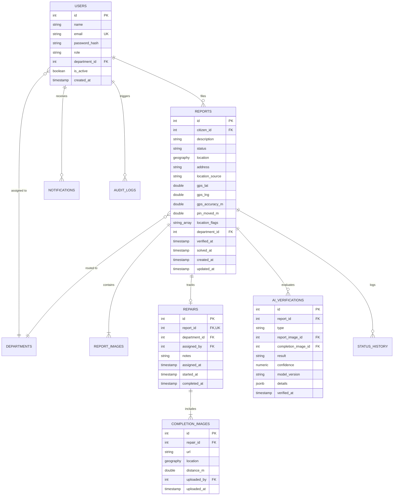
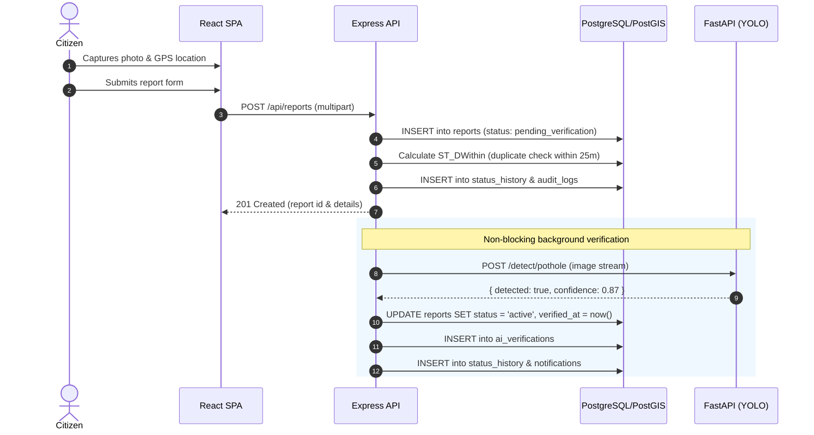
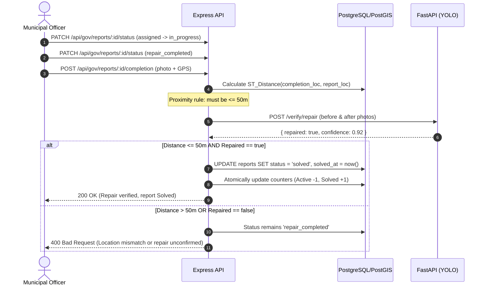

# System Architecture & Technical Design Specification

> **Project:** Smart Civic Road Issue Reporting and AI-Based Pothole Verification System  
> **Status:** Phase 0 Built · Ready for Phase 1 Design Sign-off

---

## 1. System Overview & Architecture

The platform is designed as an event-driven, decoupled system consisting of a React single-page frontend, an Express REST API backend, a PostgreSQL relational database with PostGIS spatial extensions, and a Python FastAPI computer vision microservice.

```
                           CITIZEN / PUBLIC CLIENT
                           [ React 19 + Vite SPA ]
                                      │
                                      │ HTTPS / REST (JWT)
                                      ▼
                        ┌───────────────────────────┐
                        │  Express 5 REST Backend   │
                        │   - RBAC & JWT Middleware │
                        │   - Status State Machine  │
                        │   - PostGIS Repositories  │
                        └───────┬───────────┬───────┘
                                │           │
               SQL + Spatial Queries        │ HTTP (Multipart)
                                │           │ Background async
                                ▼           ▼
           ┌───────────────────────┐     ┌────────────────────────┐
           │ PostgreSQL 17+PostGIS │     │ Python FastAPI Service │
           │ - reports table (GIS) │     │ - YOLO Detector        │
           │ - users, audit logs   │     │ - Repair Verifier      │
           │ - status history      │     └────────────────────────┘
           └───────────────────────┘
```

---

## 2. Microservice Responsibilities

### 2.1 Web Application (`client/`)
- **Technology:** React 19, Vite 8, React Router v7, React-Leaflet 5.
- **Port:** `http://localhost:5173`
- **Key Capabilities:**
  - Citizen flow: Geolocation request, map pin drag-and-drop, camera live capture, real-time status tracking.
  - Public flow: Live map with color-coded markers, counter cards (Total/Active/Solved), "How it works" guide.
  - Government flow: Role-gated dashboard (`/gov`), triage table, ward/department assignment, before/after completion photo verification interface.

### 2.2 Core Backend API (`server/`)
- **Technology:** Node.js (v20+), Express 5, `pg` (node-postgres), Multer, JWT, Bcrypt.
- **Port:** `http://localhost:5000/api`
- **Key Capabilities:**
  - Authentication & Authorization: Role-based access control (`citizen`, `government`, `admin`).
  - Strict State Machine: Handles atomic transitions and writes an entry to `status_history` on every transition.
  - Spatial Engine: Executes PostGIS distance calculations (`ST_DWithin`, `ST_Distance`) for duplicate detection and repair proximity checks.
  - Asynchronous Dispatch: Offloads image inspection to the FastAPI service non-blockingly (`setImmediate`).

### 2.3 AI / Computer Vision Microservice (`ai-service/`)
- **Technology:** Python 3.11+, FastAPI, Uvicorn, Ultralytics YOLO candidate, Pydantic.
- **Port:** `http://localhost:8000` (Docs: `http://localhost:8000/docs`)
- **Endpoints:**
  - `GET /health`: Service health and model status.
  - `POST /detect/pothole`: Analyzes initial citizen photo $\rightarrow$ returns `{ detected: boolean, confidence: float, boxes: array }`.
  - `POST /verify/repair`: Analyzes completion photo against initial photo $\rightarrow$ returns `{ repaired: boolean, confidence: float }`.

---

## 3. Database Architecture (Entity-Relationship Model)

### 3.1 Relational Schema Diagram (Mermaid)



---

## 4. End-to-End Sequence Workflows

### 4.1 Citizen Report Submission & Verification



### 4.2 Municipal Repair & Closure Verification




---

## 5. Architectural & Feature Decisions (Locked)

1. **Email Verification:** Flexible onboarding — citizens can register and access the dashboard immediately. However, submitting a pothole report (`POST /api/reports`) requires a verified email address (`email_verified = true`).
2. **Report Image Allowance:** Multiple photos supported per report: Minimum **1 image**, Maximum **5 images** (JPEG/PNG/WebP, $\le 8\text{ MB}$ each).
3. **Notification Channels:** In-app notifications only for Phase 2/3 (stored in `notifications` table and displayed in UI header/inbox).
4. **AI Training Dataset:** Candidate datasets (Pothole-600, RDD2022, local Vadodara captures) will be evaluated and finalized in Phase 4.
5. **Schema & UI Extensibility:** The PostgreSQL schema uses modular migrations (`database/migrations/`), allowing future columns and constraints to be added without breaking existing data. UI/UX styling is centrally driven via CSS custom properties in `global.css`.
